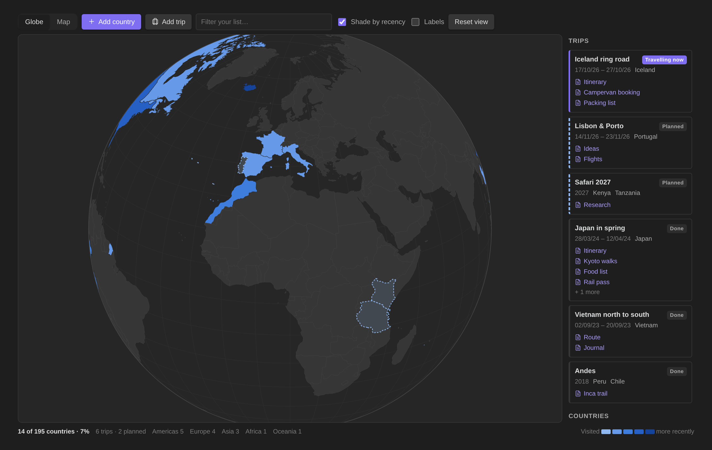
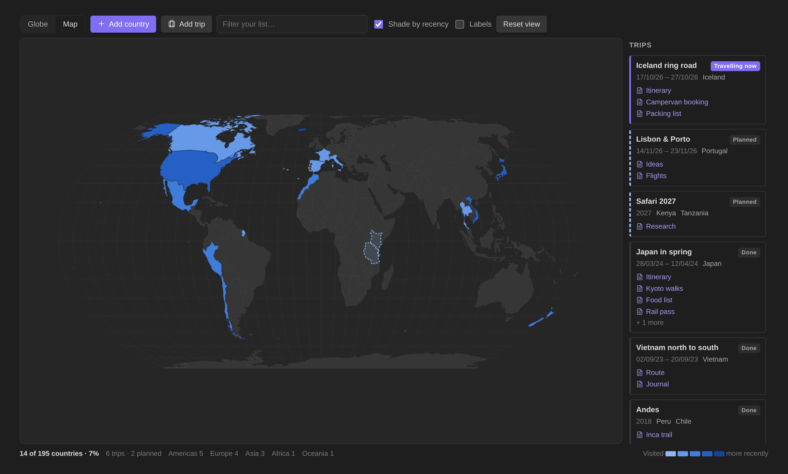

# World Map for Obsidian

A globe and a flat world map of the countries you have been to, the years you went, and the trips behind them, linked to the notes you wrote along the way.





*Screenshots use invented demo data.*

## Features

- **Globe or flat map.** Drag to spin or pan, scroll to zoom, *Reset view* to go back. Countries you have visited are shaded, darker for more recent visits (or one colour if you switch *Shade by recency* off).
- **Countries and years.** Click a country, or use *Add country*, to record the years you went and an optional note.
- **Trips.** A trip has a name, one or more countries, dates (or just a year) and any number of linked notes. Trips show in the sidebar with their notes one click away.
  - Status is worked out from the dates: *Planned*, *Travelling now* or *Done*. You can also set it by hand.
  - Done and current trips count towards your visited countries. Planned trips are drawn with a dashed outline, so you can see where you are going next.
  - *Link a whole folder* adds every note in a folder to a trip.
  - Renaming or moving a linked note keeps the link. Deleting one removes it.
- **Create trips from travel folders.** If you keep a folder per trip (for example `Travel/Japan 2026`, `Travel/Iceland-2024`), this command makes a trip for each one, with its year taken from the name and all of its notes linked.
- **Stats.** Countries visited out of 195, percentage, trip count, and a count per continent.
- **Embed a map in a note** with a `worldmap` code block (see below).
- Works on desktop and mobile. The map geometry is bundled into `main.js`, so Obsidian Sync carries everything the plugin needs.

## Commands

| Command | What it does |
| --- | --- |
| Open world map | Opens the map view (also on the ribbon). |
| Add a country you have visited | Pick a country and add years. |
| Add a trip | Opens the trip editor. |
| Create trips from travel folders | Choose a parent folder. Each subfolder named like `Place 2026` becomes a trip. |
| Insert a map here | Inserts a `worldmap` block at the cursor. |

## Embedding a map

````markdown
```worldmap
projection: globe
height: 420
centre: 140, 36
zoom: 2
stats: true
labels: false
interactive: true
```
````

Every option is optional. `projection` is `globe` or `flat` (default `flat`). `centre` is longitude, latitude. `zoom` runs from 0.6 to 12.

## Data

Everything lives in the plugin's `data.json` in your vault: visits keyed by country, trips with their linked note paths, and settings. Nothing is sent anywhere.

## Install

The plugin is not in the community directory yet. To install it by hand:

1. Download `main.js`, `manifest.json` and `styles.css` from the latest release, or build them yourself (below).
2. Copy them into `<your vault>/.obsidian/plugins/jcolorxy-world-map/`.
3. In Obsidian, go to *Settings → Community plugins*, reload, and enable **World Map**.

## Build

```sh
npm install
npm run build              # writes main.js
node --test tests/*.test.mjs # unit tests
node screenshots/shoot.mjs # regenerates docs/*.png (needs Chromium)
```

## Similar plugins

The community plugin *Visited Countries* covers similar ground. World Map adds a globe, trips with linked notes, planned trips, and embeddable maps.

## Credits

Country shapes are from [Natural Earth](https://www.naturalearthdata.com/) via [world-atlas](https://github.com/topojson/world-atlas), both in the public domain. Projections use [d3-geo](https://github.com/d3/d3-geo).

## Licence

MIT
